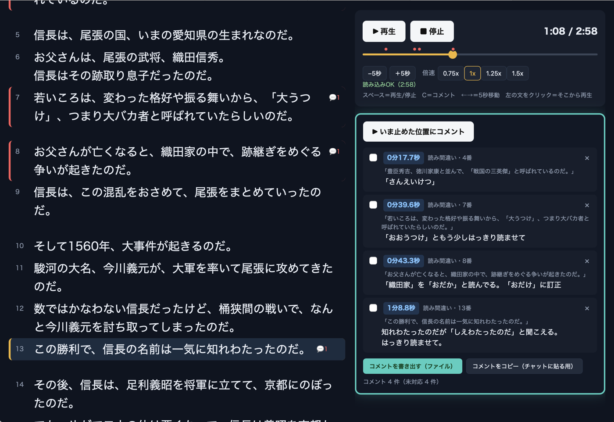

# 音声チェック

ナレーション音声を聞きながら、気になったところに秒数つきでコメントを残すツールです。
左に台本、右にプレーヤーとコメント欄が並びます。
`index.html` 1枚で動き、外部のライブラリやインターネット接続は使いません。



## 中身

| ファイル | 内容 |
|---|---|
| `index.html` | ツール本体 |
| `script.txt` | 台本（試し用のサンプル） |
| `audio.mp3` | 音声（試し用のサンプル） |
| `screenshot.png` | この説明書の画像 |

サンプルは「3分でわかる織田信長」です。ダウンロードしてすぐ試せます。
読み上げソフトで作った音声なので、ところどころ読み方の怪しいところがあります。コメント機能の練習に使ってみてください。

## 開き方（3通り）

どの方法でも、3つのファイル（`index.html`・`script.txt`・`audio.mp3`）は同じフォルダに置いておきます。

### 1. ダブルクリックで開く（いちばん簡単）

1. `index.html` をダブルクリックしてブラウザで開きます
2. 音声は自動で読み込まれます
3. 台本は自動で読み込めないので、`script.txt` を画面にドラッグするか、画面から選んでください

ブラウザには、ダブルクリックで開いたページが同じフォルダのほかのファイルを勝手に読めないようにする安全の仕組みがあるためです。

### 2. 自分のパソコンをサーバーにして開く（台本も自動で読み込む）

1. ターミナルで、3つのファイルがあるフォルダに移動して次を実行します
   ```
   python3 -m http.server 8000
   ```
2. ブラウザで http://localhost:8000 を開きます
3. 台本も音声も自動で読み込まれます（終わるときはターミナルで Ctrl+C）

### 3. お使いの AI に置いてもらう

お使いの AI に頼んで、好きなところに配置してもらってください。

## 使い方

1. 再生して、気になるところで止めます
2. 「いま止めた位置にコメント」（または C キー）で、種類を選んでコメントを書きます
   - 種類: 読み間違い / 途切れ / 間・速さ / 声の調子 / その他
3. 直し終わったコメントにはチェックを付けておけます
4. コメントは「書き出す（ファイル）」で保存、「コピー」でチャットなどに貼り付けられます

コメントはそのブラウザの中に保存されます（外には送られません）。

## ショートカット

| 操作 | キー |
|---|---|
| 再生 / 停止 | スペース |
| コメントを書く | C |
| 5秒戻る / 進む | ← / → |
| その文から再生 | 左の文をクリック |

再生速度は 0.75x / 1x / 1.25x / 1.5x から選べます。

## 自分の台本と音声で使う

`script.txt` と `audio.mp3` を自分のものに入れ替えてください。

`script.txt` の書き方:

```
# タイトル
0:00.5 1つ目の文
0:03.0 2つ目の文

0:09.7 3つ目の文
```

- 1行目が `#` で始まるとタイトルになります（なくても OK）
- 1行に1文。頭に `分:秒` を書くと、その文をクリックしたときにそこから再生します
- 秒を書かなかった文は、文字数から目安の位置を出します
- 空行で段落を区切ります

## もし動かなかったら

clone してお使いの AI に修正してもらってください。

## 制作に使ったツール

このツールは [Claude Code](https://claude.com/claude-code)（Anthropic の AI）を使って作りました。

## クレジット

- 音声（`audio.mp3`）: VOICEVOX:ずんだもん
- 台本（`script.txt`）: Wikipedia「[織田信長](https://ja.wikipedia.org/wiki/%E7%B9%94%E7%94%B0%E4%BF%A1%E9%95%B7)」の冒頭部分をもとに、内容を足して話し言葉に書き直したもの

## ライセンス

ファイルによって決まりが違います。

| ファイル | ライセンス | 使うときの条件 |
|---|---|---|
| `index.html` | [MIT License](LICENSE) | 個人・商用を問わず、自由に使ったり改造したり配ったりしてかまいません |
| `script.txt` | [CC BY-SA 4.0](https://creativecommons.org/licenses/by-sa/4.0/deed.ja) | もとが Wikipedia の文章のため。使うときは出典（Wikipedia「織田信長」）を表示し、改変したものも同じ CC BY-SA 4.0 で公開してください |
| `audio.mp3` | [VOICEVOX](https://voicevox.hiroshiba.jp/) とずんだもんの[音声ライブラリ利用規約](https://zunko.jp/con_ongen_kiyaku.html) | 「VOICEVOX:ずんだもん」のクレジットを表示すれば、商用・非商用で使えます |
| `screenshot.png` | `script.txt` と同じ CC BY-SA 4.0 | 台本の文章が写っているため |

このツールは「そのまま」の状態で提供するもので、動作や結果について何も保証しません。使ったことで起きた不利益や損害について、作者は一切責任を負いません。
